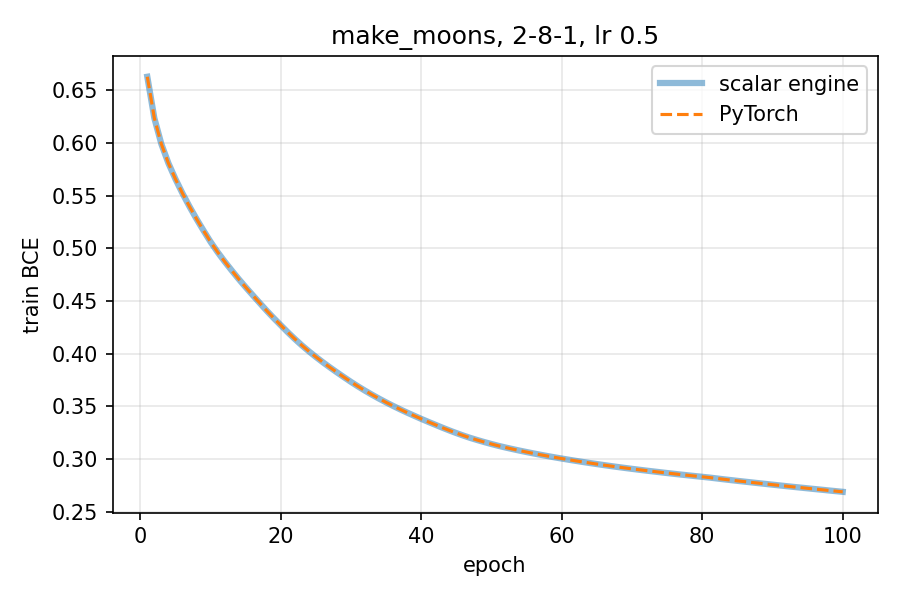

# Lab 5 — Frameworks and automatic differentiation

A scalar autodiff engine written from scratch, checked against PyTorch autograd, used to train a tiny model, and compared with PyTorch's execution modes.
Python 3.11.5, PyTorch 2.3.1 (CPU), NumPy 1.26.4, scikit-learn 1.5.0, Windows 11.

```bash
python lab05/src/run_all.py      # or the task*.py scripts one by one, from lab05/src
```

| File | Content |
|---|---|
| `src/value.py` | the `Value` engine (Tasks 1–3) |
| `src/task3_graph.py` … `src/task6_framework.py` | one script per task, `src/common.py` for seed, paths and data |
| `results/` | `graph_demo.txt`, `gradient_check.txt/.csv`, `training_times.csv`, `training_summary.csv`, `loss_curves.png`, `execution_timings.csv`, `contiguity_timings.csv`, `graphs_and_layout.txt`, `run_output.txt` |

## 1. The `Value` node

Each node stores four things, as the manual asks:

| Field | Meaning |
|---|---|
| `data` | the number computed in the forward pass |
| `grad` | ∂L/∂(this node), filled in by `backward()`, starts at 0 |
| `_parents` | the nodes this one was computed from (empty for a leaf) |
| `_backward` | the **local derivative rule**: a closure that adds this node's `grad`, times the local derivative, into each parent's `grad` |

`_op` keeps the operation's name for printing the graph. `__slots__` keeps each node small, since training builds about 12,000 nodes per epoch.

## 2. Operations build the graph

`+`, `*`, `**k` and `relu()` each compute the result and return a **new** `Value` whose parents are the inputs, with its derivative rule attached:

| Op | Forward | Local rule (added to the parent's grad) |
|---|---|---|
| `a + b` | a + b | a ← 1·g, b ← 1·g |
| `a * b` | a·b | a ← b·g, b ← a·g |
| `a ** k` | aᵏ | a ← k·aᵏ⁻¹·g |
| `relu(a)` | max(0, a) | a ← 1[a > 0]·g |

(g is the output node's grad.) Subtraction, negation and division are built from these, and constants are wrapped as leaf `Value`s.
For Task 5, I also added `exp`, `log` and `sigmoid`, using the same pattern.

Writing the expression *is* building the graph: there is no separate graph-definition step. That is eager-mode, define-by-run behaviour, as in PyTorch.
`results/graph_demo.txt` prints the graph of `f = (x*y + x)**2` that this builds:

```
n0 leaf (x=2)   n1 leaf (y=-3)   n2 *(n0,n1)   n3 +(n2,n0)   n4 **2(n3)
```

## 3. Backward pass

`Value.backward()` does the four steps the manual lists:

1. **Topological sort** with an iterative depth-first search, so every node comes after all of its parents. Being iterative, a deep graph cannot hit Python's recursion limit.
2. **Seed** the output: `self.grad = 1`.
3. **Visit in reverse** topological order, so a node's grad is complete before it is passed on to its parents.
4. **Accumulate:** every rule uses `+=`. A node used in several places receives the sum of all paths, which is the multivariable chain rule.

Checks (`results/graph_demo.txt`):

| Test | Engine | By hand |
|---|---|---|
| f = (x·y + x)² at x=2, y=−3: ∂f/∂x, ∂f/∂y | 16, −16 | 2x(y+1)² = 16, 2x²(y+1) = −16 |
| g = a·a + a at a=3 (a used 3 times): ∂g/∂a | **7** | 2a + 1 = 7 |
| relu′ at −1.5 / 0 / 2.5 | 0 / 0 / 1 | 0 / 0 (convention) / 1 |

The `g` case is the accumulation test. If the rules overwrote with `=`, the last rule to run would win, giving 1 or 3 instead of 7.

## 4. Verification against PyTorch and numerical gradients

The expression is `((a*b + c)**2).relu().sum()`, where a, b, c are 3×4 arrays drawn from N(0, 1) with seed 42, in float64. The engine works element by element and sums the 12 outputs. PyTorch gets the same arrays as tensors with `requires_grad=True`.
The numerical gradient is the central difference `[f(x+ε) − f(x−ε)] / 2ε` with ε = 1e-6 (`results/gradient_check.csv` lists all 36 gradients).

| Comparison | Max absolute difference | Required |
|---|---:|---:|
| Forward value, engine vs PyTorch | 1.8e-15 | |
| Gradients, engine vs PyTorch autograd | **0.0** | < 1e-6 |
| Gradients, engine vs central difference | **1.9e-9** | < 1e-6 |

**PASS.** The engine and PyTorch agree to the last bit, because they perform the same float64 operations in the same order.
The remaining 1.9e-9 against the central difference is the truncation and rounding error of the finite difference itself, not a gradient error.

With this expression the ReLU input is a square, so it is never negative and the ReLU always passes the gradient through. The ReLU's zero branch is therefore tested separately in Task 3, at −1.5 and 0.

## 5. Tiny model on make_moons: engine vs PyTorch

- **Data:** `make_moons(200, noise=0.15, random_state=42)`, split 70/30 stratified, giving 140 train and 60 test points.
- **Model:** 2 → 8 (ReLU) → 1 (sigmoid), with the BCE loss written out as `−[y·log p + (1−y)·log(1−p)]`, averaged over the batch.
- **Training:** full-batch gradient descent, learning rate 0.5, 100 epochs.
- **Initialisation:** He init, W ~ N(0, 2/fan_in), biases 0. Both engines start from these identical NumPy weights.

The manual does not set the hidden activation, the learning rate or the epoch count, so these are my choices. ReLU is used because the engine already has it.

Both engines run in float64 with one PyTorch thread. Each run times the whole training loop: forward, backward and update. Engine and PyTorch runs alternate, there are 5 runs each, and PyTorch has one warm-up run first (`results/training_times.csv`).

| Engine | Median of 5 runs | Per epoch | Final train BCE | Train acc | Test acc |
|---|---:|---:|---:|---:|---:|
| Scalar engine | 18.34 s | 183 ms | 0.269035 | 87.9% | 93.3% |
| PyTorch | 0.100 s | 1.0 ms | 0.269035 | 87.9% | 93.3% |

**PyTorch is about 184× faster**, and the two engines learn **the same model**. The largest parameter difference after 100 epochs is 4.4e-16, and the largest loss difference over all epochs is 4.4e-16. The two curves in `results/loss_curves.png` lie on top of each other.



**Why the gap is so large.** The engine creates a Python object and a closure for every scalar operation, 12,216 nodes per epoch, and then walks them one by one in the interpreter.
PyTorch represents the same epoch as about 10 tensor operations. Each one runs a compiled C++ loop over the whole batch, and autograd records one node per tensor operation, not one per number.
The gradients are identical. The speed difference is per-operation overhead and the lack of vectorisation, which is the framework overhead described in Reddi §7.4.

## 6. PyTorch: graphs, eager vs compiled, tensor layout

Model: `Sequential(Linear(2,8), ReLU, Linear(8,1), Sigmoid)`, float32, one thread. The full printouts are in `results/graphs_and_layout.txt`.

**Graphs.** The three views show the same model at three levels:

- **Autograd graph** (follow `grad_fn` → `next_functions` from `model(x).mean()`):
  `MeanBackward0 → SigmoidBackward0 → AddmmBackward0 → ReluBackward0 → AddmmBackward0`. The weights appear as `TBackward0 → AccumulateGrad` leaves.
  This is the backward graph that PyTorch records *while* the forward pass runs, the same idea as `Value._parents` and `_backward`. `AccumulateGrad` is the `+=` of Task 3.
- **`torch.fx.symbolic_trace`:** a Python-level forward graph with nodes placeholder → call_module 0…3 → output.
- **`torch.jit.trace`:** a TorchScript graph recorded from one example input, with the shape and dtype baked in: `Float(64, 2, strides=[2, 1])`.

**torch.compile is not supported on this machine.** Its default backend (inductor) generates C++ code and needs a C++ compiler at run time. None is installed, so it fails with:

```
BackendCompilerFailed: InvalidCxxCompiler: No working C++ compiler found in torch._inductor.config.cpp.cxx: (None, 'g++')
```

As the manual allows, eager mode is compared with `torch.jit.trace` and `torch.jit.script` instead.
Every variant was warmed up for 50 calls per input shape. The figure reported is the median of 15 blocks of 200 calls, under `no_grad`, and the outputs were checked against eager (`results/execution_timings.csv`).

| Batch | Eager µs/call | jit.trace | jit.script | Speed-up trace / script |
|---:|---:|---:|---:|---|
| 1 | 120.5 | 111.9 | 86.3 | 1.08× / 1.40× |
| 64 | 133.5 | 115.9 | 99.5 | 1.15× / 1.34× |
| 4096 | 549.0 | 656.1 | 513.0 | 0.84× / 1.07× |

- **Small batches:** TorchScript saves 10–35 µs per call. Eager mode runs `Sequential.__call__` and four `Module.forward` calls through the Python interpreter, while the scripted graph runs those steps in C++.
  At batch 1, the actual arithmetic is a few dozen FLOPs, so per-call overhead *is* the run time.
- **Large batch (4096):** the gain disappears. The time is spent inside the matmul and sigmoid kernels, which are the same in every mode, so the differences are within run-to-run noise.
  An earlier run of the same script measured trace at 1.02× and script at 0.95× at this size, against 0.84× and 1.07× here.

**Tensor layout.** `a` is a 4096×4096 float32 tensor:

| Tensor | Shape | dtype | Stride | Contiguous |
|---|---|---|---|---|
| `a` | (4096, 4096) | float32 | (4096, 1) | True |
| `a.t()` (view, same memory) | (4096, 4096) | float32 | (1, 4096) | **False** |
| `a[:, ::2]` (view) | (4096, 2048) | float32 | (4096, 2) | **False** |
| `a.t().contiguous()` (copy) | (4096, 4096) | float32 | (4096, 1) | True |

A view changes only the strides, not the data. `a.t()` shares its storage with `a`, and `a.t().view(-1)` raises a RuntimeError, because a flat view needs contiguous memory.

**How a non-contiguous view changes speed** (median of 30 runs, `results/contiguity_timings.csv`):

| Operation | Contiguous | Non-contiguous view | Slowdown |
|---|---:|---:|---:|
| Row sum `x.sum(dim=1)` on `a.t()` | 44.5 ms | 97.5 ms | **2.19×** |
| Elementwise `x*2+1` on `a[:, ::2]` | 17.8 ms | 28.0 ms | **1.57×** |
| Elementwise `x*2+1` on `a.t()` | 32.7 ms | 31.2 ms | 0.95× |
| `x.clone()` on `a.t()` | 16.5 ms | 16.5 ms | 1.00× |
| Matrix-vector `x @ v` on `a.t()` | 6.3 ms | 5.9 ms | 0.95× |
| Making it contiguous: `a.t().contiguous()` | | 92.0 ms | |

The cost depends on the access pattern, not just on the contiguous flag:

- **Reducing across the strided dimension is slow.** Summing a row of `a.t()` jumps 4,096 floats (16 KB) between neighbouring elements, so almost every read misses the cache. That makes it 2.2× slower.
- **A slice with gaps** (`::2`) wastes half of every cache line it loads, and the vectorised loop cannot run on it, so elementwise operations are 1.6× slower.
- **A plain transpose costs nothing for elementwise ops, clone or matmul.** PyTorch sees that the memory is still dense, just in a different order, and walks it in memory order. Matmul simply calls BLAS with the "transposed" flag.
- **Copying with `.contiguous()` is itself expensive:** 92 ms, about twice one slow row sum. It only pays off when the same tensor is reused many times.

## When compilation helps

- **It helps when overhead dominates:** small batches, many small operations, and Python-heavy `forward` code. Here TorchScript gave a 1.1–1.4× speed-up at batch 1–64.
  A real compiler such as torch.compile/inductor does more: it **fuses** elementwise chains (Linear → ReLU → …) into one kernel, so intermediate tensors are not written to memory and read back.
- **It does not help when time is spent inside big kernels** (large matmuls, large batches). The kernels are already optimised, so the gain is near zero, as at batch 4096 here.
- **It costs something:** compile time on the first call (seconds for inductor), a recompile whenever the input shape or dtype changes, and a toolchain that may be missing. On this Windows machine, inductor could not run at all for lack of a C++ compiler.
  Tracing records only one path, so it silently ignores data-dependent `if` statements. Scripting handles those but supports only a subset of Python.
- **Rule of thumb:** compile a model that is stable and runs many times with the same shapes, such as production inference or long training. Stay in eager mode while developing and debugging.
